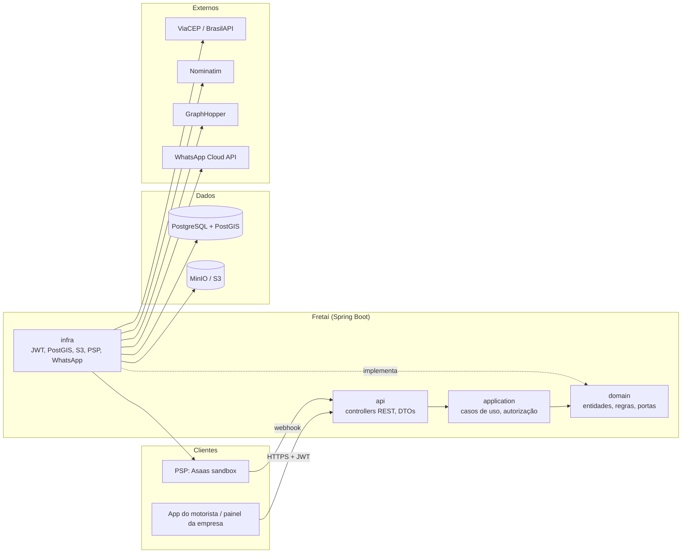
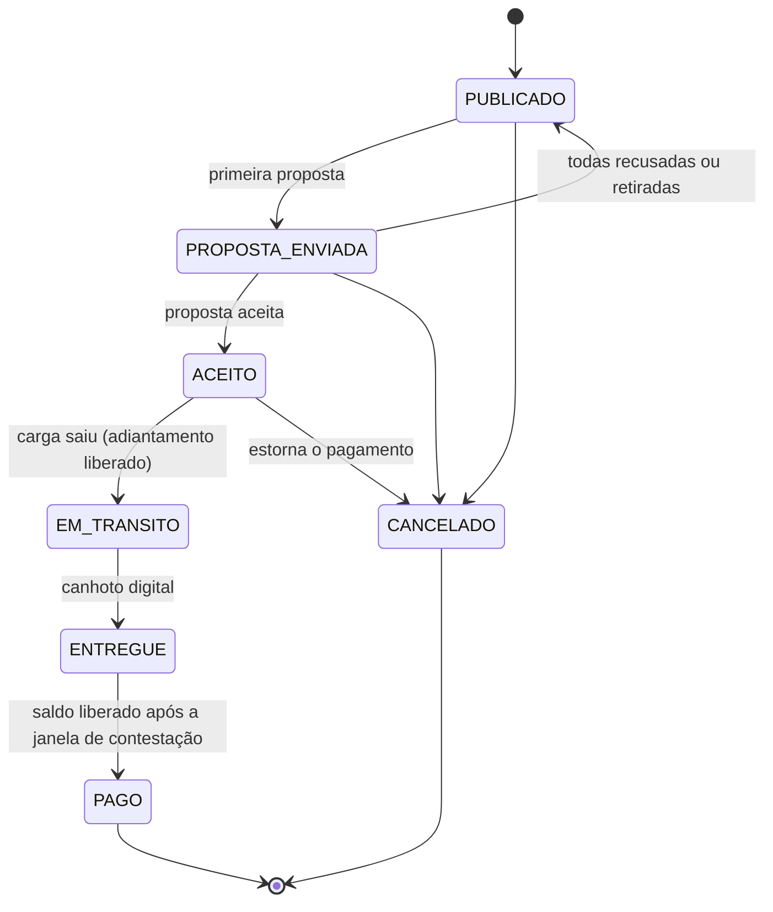

# Fretaí

**O Fretaí resolve o calote no frete.**

O caminhoneiro autônomo aceita uma carga confiando na palavra de quem a oferece. Recebe parte na saída, e o saldo fica para depois da entrega. É nesse depois que o calote acontece: o saldo atrasa, encolhe ou nunca chega. Do outro lado, a empresa não sabe se o motorista é quem diz ser e se a carga chegou inteira.

O Fretaí liga empresas que têm carga a caminhoneiros autônomos e tira a confiança cega do meio:

- **O dinheiro existe antes de a carga sair.** No aceite, a empresa paga por Pix e o valor fica retido no provedor de pagamento (PSP). O motorista vê `RETIDO` antes de carregar.
- **Adiantamento na saída, saldo na entrega comprovada.** O PSP libera a parte combinada quando a carga sai. O resto sai quando o canhoto digital é aceito e ninguém contesta no prazo.
- **Canhoto digital.** Foto, assinatura do recebedor e GPS conferido contra o endereço de entrega. Quem recebeu ganha um código para contestar.
- **Preço justo e golpe à vista.** O piso mínimo da ANTT (Lei 13.703/2018) aparece em todo frete. A API avisa quando a oferta está abaixo dele ou muito acima da média de rotas parecidas, o golpe do "fretão".
- **Reputação dos dois lados.** Notas depois da entrega, % de saldos pagos em dia da empresa e documentos verificados do motorista.
- **Documentos sem WhatsApp.** CNH e CRLV ficam no sistema. A empresa só os vê depois de aceitar aquele motorista, por link que expira, e cada acesso fica registrado.

O Fretaí nunca guarda dinheiro: só orquestra o PSP.

O fluxo original, de cliente pessoa física que pede um frete pontual, continua funcionando lado a lado com o marketplace de empresas.

## Como rodar

Requisitos: Docker. Para desenvolver fora do contêiner, também JDK 21 ou superior.

```bash
git clone https://github.com/celoramos/Fretai.git
cd Fretai
docker compose up --build
```

Isso sobe três serviços:

| Serviço | Endereço | O que é |
|---|---|---|
| `app` | http://localhost:8080 | a API; Swagger em `/swagger-ui.html` |
| `postgres` | localhost:5432 | PostgreSQL 17 com PostGIS |
| `minio` | http://localhost:9001 | armazenamento de documentos compatível com S3 (console) |

Para desenvolver pelo IDE, suba só o banco e o MinIO e rode a aplicação pelo Maven:

```bash
docker compose up -d postgres minio
.\mvnw.cmd spring-boot:run        # Windows
```

Fora do compose a aplicação usa o disco local (`./dados/arquivos`) para documentos e o PSP falso, sem precisar de nenhuma chave.

O arquivo [`requisicoes/fluxo-completo.http`](requisicoes/fluxo-completo.http) percorre o fluxo inteiro, do cadastro da empresa até a avaliação, passando pelo pagamento retido e pelo saldo liberado. Abra no IntelliJ e rode em ordem.

### Configuração

Nada de segredo no código: tudo sensível vem de variável de ambiente. O modelo completo está em [`application-example.yml`](application-example.yml).

| Variável | Para quê | Sem ela |
|---|---|---|
| `DB_URL`, `DB_USER`, `DB_PASSWORD` | banco | valores do `docker-compose.yml` |
| `FRETAI_JWT_SEGREDO` | assinatura dos tokens (32+ bytes) | segredo aleatório a cada subida |
| `FRETAI_GOOGLE_CLIENT_ID` | login e cadastro com Google (ID do cliente OAuth, tipo Aplicativo da Web) | `/api/auth/google` responde 422 |
| `FRETAI_ADMIN_EMAIL`, `_SENHA`, `_CPF` | primeiro administrador | nenhum administrador |
| `FRETAI_ARQUIVOS_PROVEDOR` | `local` ou `s3` | `local` |
| `S3_ENDPOINT`, `S3_ACCESS_KEY`, `S3_SECRET_KEY`, `S3_BUCKET` | S3/MinIO | — |
| `ASAAS_CHAVE`, `ASAAS_WEBHOOK_TOKEN` | PSP Asaas (sandbox), com o profile `asaas` | PSP falso |
| `WHATSAPP_TOKEN`, `WHATSAPP_PHONE_NUMBER_ID` | WhatsApp Cloud API, com `fretai.whatsapp.habilitado=true` | notificações no log |
| `FRETAI_JANELA_CONTESTACAO` | prazo para contestar a entrega | 24 h |
| `GRAPHHOPPER_CHAVE` | distância de estrada | linha reta × 1,3 |

Outros números de negócio ficam em `application.yml`, como o raio do canhoto, o fator de suspeita do "fretão" e o raio do frete de retorno.

## Arquitetura

Um único serviço Spring Boot (Java 21, Spring Boot 4.1), dividido em módulos por assunto. Cada módulo tem as mesmas quatro camadas, e o `ArquiteturaTest` (ArchUnit) confere a cada build que nenhuma camada invade a outra e que não há ciclo entre módulos.



| Camada | Contém | Pode depender de |
|---|---|---|
| `domain` | entidades, regras de negócio, interfaces de repositório e de serviços externos | só de outro `domain` e de `shared` |
| `application` | casos de uso (services), DTOs e checagem de dono do recurso | `domain` |
| `api` | controllers REST | `application` e `domain` |
| `infra` | integrações externas e configuração técnica | `domain` |

| Módulo | Assunto |
|---|---|
| `auth` | login, JWT, refresh token, limite de tentativas |
| `usuario` | pessoas: cliente, motorista, administrador |
| `empresa` | empresas (embarcador e agenciador) e consulta de CNPJ |
| `veiculo` | caminhões do motorista |
| `frete` | frete, propostas, máquina de estados, busca por raio, frete de retorno |
| `precificacao` | piso ANTT, custo da viagem, alertas de preço |
| `reputacao` | avaliações e perfis públicos |
| `arquivo` | armazenamento com link assinado (local ou S3) |
| `documento` | CNH, CRLV e comprovantes, com registro de acesso |
| `pagamento` | cobrança, retenção, adiantamento, saldo, estorno, webhooks |
| `entrega` | canhoto digital e contestação |
| `notificacao` | avisos por log ou WhatsApp |
| `endereco`, `rota`, `calendario` | CEP, geocodificação, distância, feriados |
| `shared` | erros, papéis, usuário logado |

Os módulos conversam por eventos do Spring quando um não deve conhecer o outro. O frete publica `TransporteIniciado`; o pagamento escuta e manda o PSP liberar o adiantamento. O frete não sabe que pagamento existe.

## Ciclo de vida do frete



As transições estão numa tabela só (`MaquinaEstadosFrete`), e o `MaquinaEstadosFreteTest` confere a tabela inteira, par a par. O status só muda por métodos da entidade `Frete`, e cada mudança grava um `EventoFrete` com de onde, para onde, quem e quando: é a trilha de auditoria de `GET /api/fretes/{id}/eventos`.

Depois que a carga sai não há cancelamento: problema na entrega é contestação, que bloqueia o saldo até um administrador decidir.

O pagamento tem o seu próprio ciclo: `PENDENTE → RETIDO → ADIANTAMENTO_LIBERADO → LIBERADO`, ou `ESTORNADO` se o frete for cancelado antes da saída.

## Endpoints

Todos exigem `Authorization: Bearer <accessToken>`, exceto os marcados como públicos. Erros seguem o formato ProblemDetail (RFC 9457).

**Autenticação**

| Método | Caminho | O que faz |
|---|---|---|
| POST | `/api/auth/login` | público; devolve access token (15 min) e refresh token |
| POST | `/api/auth/refresh` | público; troca o refresh token por um par novo |
| POST | `/api/auth/logout` | revoga o refresh token |
| GET | `/api/auth/eu` | quem está logado |

**Cadastros**

| Método | Caminho | O que faz |
|---|---|---|
| POST | `/api/clientes` | público; cadastra cliente pessoa física |
| POST | `/api/empresas` | público; cadastra empresa (razão social lida da Receita) e o responsável |
| GET | `/api/empresas` | lista empresas ativas, paginado |
| GET / PUT / DELETE | `/api/empresas/{id}` | detalhe, edição e desativação (só a própria empresa) |
| GET | `/api/empresas/{cnpj}` | público; dados de um CNPJ na Receita |
| POST | `/api/motoristas` | público; cadastra motorista |
| GET | `/api/motoristas` | lista motoristas (empresa e admin) |
| GET / PUT / DELETE | `/api/motoristas/{id}` | detalhe, edição e desativação (só o próprio) |
| PATCH | `/api/motoristas/{id}/preferencias` | aceita ou não frete em feriado |
| PUT | `/api/motoristas/{id}/chave-pix` | chave Pix para receber |
| PUT | `/api/motoristas/{id}/base` | base e raio para avisos de frete novo |
| POST / GET | `/api/motoristas/{id}/veiculos` | cadastra e lista caminhões (só o próprio) |
| GET / PUT / DELETE | `/api/motoristas/{id}/veiculos/{veiculoId}` | detalhe, edição e desativação |

**Fretes e negociação**

| Método | Caminho | O que faz |
|---|---|---|
| POST | `/api/fretes` | cliente pessoa física solicita frete |
| GET | `/api/fretes/cliente/{clienteId}` | fretes do cliente pessoa física, paginado (só ele e admin) |
| POST / GET | `/api/fretes/empresa/{empresaId}` | empresa publica frete / lista os seus |
| GET | `/api/fretes?status=PUBLICADO` | lista por status, paginado |
| GET | `/api/fretes/busca` | busca por raio: origem (lat/lng ou CEP), raio, destino, veículo, carroceria, filtros SIM/NAO/AMBOS |
| GET / PUT | `/api/fretes/{id}` | detalhe (com piso ANTT e alertas) / edição pela empresa antes de propostas |
| GET | `/api/fretes/{id}/eventos` | trilha de auditoria |
| GET | `/api/fretes/{id}/retorno` | sugestões de frete de volta para o motorista |
| POST / GET | `/api/fretes/{id}/propostas` | envia proposta / lista (motorista vê só as dele) |
| GET | `/api/propostas/minhas` | propostas do motorista logado |
| POST | `/api/propostas/{id}/aceite`, `/recusa`, `/retirada` | responde ou retira |
| POST | `/api/fretes/{id}/aceite` | aceite direto pelo valor anunciado |
| POST | `/api/fretes/{id}/inicio`, `/conclusao`, `/cancelamento` | transições |

**Preço**

| Método | Caminho | O que faz |
|---|---|---|
| POST | `/api/calculadora/frete` | custo da viagem (diesel, pedágio, outros), piso e margem |
| GET | `/api/piso-antt` | tabela de coeficientes em uso |
| GET / PUT | `/api/piso-antt/{tipoCarga}/{eixos}` | consulta / atualiza um coeficiente (admin) |

**Pagamento, entrega e documentos**

| Método | Caminho | O que faz |
|---|---|---|
| POST / GET | `/api/fretes/{id}/pagamento` | gera a cobrança Pix / consulta o pagamento |
| POST | `/api/webhooks/pagamentos` | público; webhook do PSP (token no cabeçalho) |
| POST / GET | `/api/fretes/{id}/canhoto` | registra o canhoto (multipart) / consulta |
| POST | `/api/fretes/{id}/canhoto/contestacao` | contratante contesta a entrega |
| POST | `/api/canhotos/contestacao` | público; recebedor contesta com o código |
| POST | `/api/fretes/{id}/canhoto/resolucao` | admin resolve a contestação |
| POST / GET | `/api/fretes/{id}/documentos` | motorista envia (multipart) / lista o que cada um pode ver |
| POST | `/api/documentos/{id}/link` | link temporário; registra o acesso |
| GET | `/api/documentos/{id}/acessos` | quem abriu o documento (dono e admin) |
| POST | `/api/documentos/{id}/verificacao` | admin marca como verificado |
| GET | `/api/arquivos/{token}` | público; baixa pelo link assinado (armazenamento local) |

**Reputação e utilidades**

| Método | Caminho | O que faz |
|---|---|---|
| POST / GET | `/api/fretes/{id}/avaliacoes` | avalia o outro lado depois da entrega / lista |
| GET | `/api/empresas/{id}/perfil` | média, fretes, % de saldos pagos em dia |
| GET | `/api/motoristas/{id}/perfil` | média, fretes concluídos, documentos verificados |
| GET | `/api/empresas/{id}/avaliacoes`, `/api/motoristas/{id}/avaliacoes` | avaliações recebidas |
| GET | `/api/feriados/{ano}`, `/api/calendario/verificacao` | públicos; feriados nacionais |

| Status | Quando |
|---|---|
| 400 | campo inválido (a resposta traz `erros` por campo), ordenação por campo inexistente |
| 401 | sem token, token inválido, login errado, webhook sem token válido |
| 403 | recurso de outra pessoa ou papel sem permissão |
| 404 | não existe (ou link de arquivo inválido/expirado) |
| 409 | duplicado, transição de status inválida, edição concorrente |
| 422 | regra de negócio: CEP inexistente, veículo incompatível, GPS longe do destino, arquivo em formato não aceito |
| 429 | muitas tentativas de login (com `Retry-After`) |
| 503 | serviço externo fora do ar |

## Decisões técnicas

**Dois tipos de contratante, uma tabela de frete.** Um frete pertence a um cliente (pessoa física) ou a uma empresa, nunca aos dois, e um `CHECK` no banco garante isso. Assim o fluxo original não quebrou e o marketplace reusa endereço, rota, feriado e a máquina de estados.

**PostGIS sem ensinar geometria ao Hibernate.** As colunas `geography(Point)` são geradas pelo próprio PostgreSQL a partir de latitude e longitude (`GENERATED ALWAYS AS ... STORED`). O Java grava números; a busca por raio é SQL nativo (`ST_DWithin` + `ST_Distance`) atrás da interface `BuscaFretes`, com índices GIST. Migrations exclusivas do Postgres ficam em `db/vendor/postgresql`, e o H2 dos testes roda as demais.

**Toda integração atrás de interface, com uma implementação local.** PSP (`FakeGatewayPagamento` / `AsaasGatewayPagamento`), arquivos (`LocalArmazenamentoArquivos` / `S3ArmazenamentoArquivos`) e notificação (`LogNotificador` / `WhatsAppCloudNotificador`). O padrão sempre é a versão local: o projeto roda e testa sem nenhuma chave.

**O Asaas só sobe em sandbox.** Com o profile `asaas`, a aplicação se recusa a iniciar se a URL não for a do sandbox.

**Escrow: honestidade sobre o limite.** Nesta versão, com o Asaas, o valor fica na conta da plataforma no PSP e sai por transferência Pix. Para custódia de verdade em produção, em que a plataforma não detém o dinheiro nem contabilmente, é preciso usar subcontas com split ou a conta escrow do PSP. Isso exige contrato com o PSP e não foi implementado.

**Webhooks idempotentes.** O id do evento do PSP é chave primária de `webhook_recebido` e é gravado antes de qualquer efeito. Reenvio vira no-op, e dois reenvios simultâneos esbarram na chave. O token é comparado em tempo constante.

**Reações a eventos nunca derrubam quem as provocou.** Liberar adiantamento, agendar saldo e notificar rodam depois do commit, numa transação programática nova dentro de try/catch. Se o PSP cair na hora da saída, a saída vale e o job de liberação tenta o adiantamento de novo.

**JWT curto, refresh longo e rotativo.** O access token dura 15 min e não é guardado. O refresh token é opaco, guardado só como SHA-256 e trocado a cada uso; se um token já usado reaparecer, todas as sessões do usuário caem (sinal de roubo). O login roda BCrypt mesmo para e-mail inexistente, para o tempo de resposta não revelar quem tem conta.

**Autorização em dois níveis.** `@PreAuthorize` nas rotas que levam o id do dono na URL; checagem de dono no service quando o dono é do recurso (ex.: só a empresa que publicou edita o frete).

**Documentos e arquivos.** O formato é reconhecido pelos primeiros bytes, não pela extensão. A chave de armazenamento nunca vem do usuário. Ninguém baixa direto: pede um link que expira em minutos, e cada link gerado vira um registro de acesso.

**Piso ANTT configurável e marcado.** Os coeficientes ficam no banco, editáveis por administrador. O seed é de **exemplo** e a API diz isso (`coeficientesDeExemplo: true`) em todo frete até a tabela ser preenchida. Piso e alertas são gravados no frete como foto do momento e refeitos no aceite com os eixos reais do caminhão.

**Concorrência otimista.** `@Version` no frete e no pagamento: dois aceites ao mesmo tempo, ou webhook e job juntos, e só o primeiro grava. O segundo recebe 409.

## Testes

```bash
.\mvnw.cmd verify
```

São cerca de 180 testes. Os de domínio e de service usam JUnit 5 e Mockito. Os de integração sobem a aplicação inteira contra um H2 em modo PostgreSQL com as mesmas migrations, passam pela segurança de verdade (login, tokens) e simulam só as integrações externas.

Os testes que precisam de PostGIS de verdade (`PostgresSchemaTest`, `BuscaPorRaioPostgisTest`) usam Testcontainers com a imagem `postgis/postgis` e são pulados quando não há Docker.

## Convenções

- Toda mudança no banco é um novo arquivo em `db/migration` (ou `db/vendor/postgresql`). Arquivos que já rodaram não são editados.
- Dinheiro e peso são `BigDecimal`, nunca `double`.
- Entidades não são devolvidas pela API: a resposta sempre passa por um DTO, e nenhum DTO de resposta tem senha, CPF ou chave Pix.
- CPF, CNPJ, telefone e placa são guardados sem máscara.
- Excluir pela API desativa; o histórico continua.

## Pendente

- **Tabela da ANTT:** substituir os coeficientes de exemplo pelos vigentes (`PUT /api/piso-antt/{tipoCarga}/{eixos}`, como administrador).
- **Verificado só em teste local:** as integrações Asaas, WhatsApp e S3/MinIO foram escritas a partir da documentação pública e não rodaram contra os serviços reais. A busca por raio e os avisos por proximidade só rodam com PostGIS; os testes deles existem, mas são pulados sem Docker.
- **Custódia real do pagamento** (split/escrow do PSP), como descrito acima.
- **Contestação procedente:** o saldo fica bloqueado; o acerto (estorno parcial, etc.) ainda é manual.
- `CategoriaVeiculo.suporta(pesoKg)` (fluxo de pessoa física) ainda aceita qualquer peso.
- Limite de tentativas de login em memória: com mais de uma instância, trocar por Redis.
- Interface web: o front em [`frontend/`](frontend/README.md) cobre login, busca e andamento do motorista, e fretes e propostas da empresa. Cadastros, publicação, canhoto, carteira e admin ainda não têm tela.
